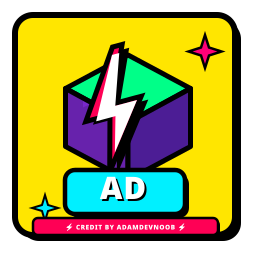

# ⚡ AD LAUNCHER (Linux Native Edition)

<div align="center">



**Ultra-Fast Native Minecraft Launcher for Linux with Cartoon Neo-Brutalism Aesthetics & Extreme FPS Boost**  
*Created with ❤️ by **AdamDevnoob***

[](https://www.rust-lang.org/)
[](https://gtk.org/)
[](https://www.debian.org/)
[](LICENSE)
[-success?style=for-the-badge&logo=minecraft)]()

</div>

---

## 🚀 Overview

**AD Launcher** is an ultra-lightweight, 100% native Linux Minecraft launcher built in **Rust** and **GTK4**. Unlike bloated Electron/Chromium-based launchers that eat 400MB+ RAM before Minecraft even starts, AD Launcher runs at under **25 MB RAM idle**, starts up in milliseconds, and provides hardware-level optimizations for modern and low-end hardware.

Featuring a signature **Cartoon Neo-Brutalism theme** with punchy outlines, vivid pop colors, dynamic smooth scrolling, and complete access to all **600+ official Minecraft versions**.

---

## ✨ Key Features

### 🌐 1. Complete Minecraft Version Catalog (All Versions Supported)
- **Every Version Ever Released**: One-click download and launch for any official release (**1.21.4, 1.20.1, 1.16.5, 1.12.2, 1.8.9**, down to 1.0), snapshots, and nostalgic retro Beta/Alpha releases directly from Mojang manifest.
- **Instant Search & Filter**: Real-time reactive search by version ID and category filter (Releases, Snapshots, Retro Beta/Alpha, All).
- **Fast Multithreaded Downloader**: Automatic library resolution, Linux x86_64 native extractor, and asset verification with SHA-1 checksums.

### 🎨 2. Vibrant Cartoon Neo-Brutalism UI
- **Zero White Buttons**: Completely customized button palette (Cyber Cyan, Neon Emerald, Electric Yellow, Vivid Purple, Electric Amber, Coral Red).
- **Custom Neo-Brutalist Scrollbars**: Fluid, chunky scrollbars designed for seamless navigation.
- **Responsive Layout**: Full screen and windowed modes with dynamic vertical scrolling on every view.

### 🖥️ 3. Fullscreen & Resizability
- **Fullscreen Mode**: Toggle fullscreen effortlessly with the dedicated UI button or press `F11`.
- **Resizable**: Adapts beautifully to laptop screens (1366x768), 1080p, 1440p, and 4K displays.

### ⚡ 4. Adam Turbo Extreme FPS Boost (Tuned for Intel HD 620 & i3)
- Tuned for Intel Core i3-7100U / Intel HD Graphics 620 / 8 GB RAM Debian Linux targets.
- Pre-configured presets:
  - **🚀 HYPER BOOST (ADAM TURBO - 240 FPS)**: Low-pause G1GC flags, multi-threaded OpenGL, RAM-guard protection.
  - **★ BALANCED (3 GB, 6 Chunks)**: Perfect sweet spot for Sodium + Iris + Lithium.
  - **⚡ LOW RESOURCE (2 GB, 4 Chunks)**: Maximum battery saver and cool thermals for potato laptops.

### 🧩 5. Built-in Modding & Shaders (Modrinth API v2)
- Direct Modrinth integration: search, download, and install performance mods (Sodium, Iris, Lithium, FerriteCore) with 1 click.
- Integrated **Shader Center** and **Shader Lab**: Toggle shaders, test compatibility, and apply potato calibrations.

### 🔐 6. Account Management
- **Official Microsoft OAuth 2.0**: Secure Device Code Flow (`microsoft.com/devicelogin`). Zero passwords stored locally.
- **Offline / Local Profiles**: One-click setup for LAN parties and offline play.

---

## 🛠️ Building & Installation

### Prerequisites
On Debian / Ubuntu / Linux Mint:
```bash
sudo apt update
sudo apt install -y build-essential libgtk-4-dev libssl-dev pkg-config openjdk-21-jre
```

### Build from Source
```bash
# Clone the repository
git clone https://github.com/AdamDevnoob/ad-launcher.git
cd ad-launcher

# Run development build
cargo run

# Build optimized production release binary
cargo build --release
```
The compiled binary will be located at `target/release/nux-launcher`.

---

## 🎮 Shortcuts & Controls

| Shortcut / Control | Action |
| :--- | :--- |
| `F11` | Toggle Fullscreen / Windowed mode |
| `Search Box` (Downloads) | Instantly filter 600+ Minecraft versions |
| `Big Play Button` | One-click launch with active profile and Turbo optimizations |

---

## 📜 License

This project is licensed under the **GNU General Public License v3.0** (`GPL-3.0-or-later`).  
See the [LICENSE](LICENSE) file for more information.

---

<div align="center">

**⚡ Built with passion by AdamDevnoob ⚡**

</div>
